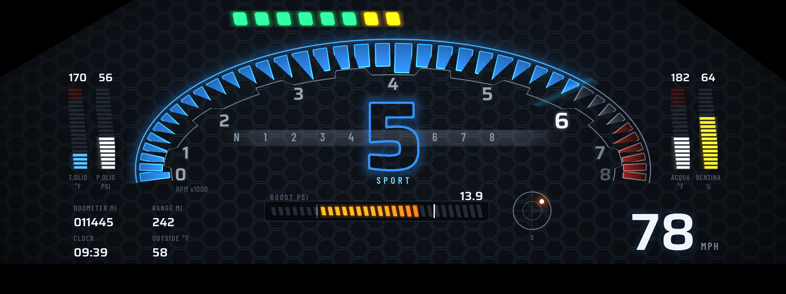

# MGU-Styles — "Toro"

A custom instrument cluster for BMW iDrive 7 (MGU), drawn in the style of a
modern Lamborghini: a wide elliptical rev band, a huge hollow gear numeral in
arancio, Italian-labelled side pods — plus two things the factory car never
had, a **boost gauge** and **GT3 three-stage shift lights with a limiter
flash**.

It runs on a rooted head unit through
[`cluster-render`](https://github.com/robertnisipeanu/idrive-apps), installed
from the [MGU Store](https://github.com/robertnisipeanu/mgu-store).


> **Unofficial, and nothing to do with BMW AG or Automobili Lamborghini.**
> Changing what your cluster shows can distract you and may affect your
> warranty. The car's own warning lights and its bottom strip are never
> covered. Test it parked.

---

## Status

| | |
|---|---|
| Target car | 2023 **X3 M40i** (G01, B58, ZF 8HP) — the car it is developed against |
| Units | imperial (mph, °F, psi); metric available |
| Head unit | iDrive 7 (ID7). iDrive 8 is planned — `cluster-render` already supports it |
| Tried on a car | **not yet.** Everything below is verified in the preview and by tests |

## The design

The reference is the Huracán/Aventador cluster: one dominant sweep, a huge
central gear, and quiet instrumentation pushed to the edges.

- **Rev band** — a wide, shallow *ellipse*, twice as wide as it is tall,
  ending where its tangent turns vertical. A circular dial sits in a 1920×720
  cluster; this one spans it, which is the whole architecture of the clusters
  it is drawn after. Ticks are solved in real pixels against each tick's own
  tangent and normal, so they stay square while their spacing tightens
  towards the ends. Each is a milled block, dark at the rim and bright at its
  inner end, with a lit edge.
- **Stepped bezel** — a hairline inside the blocks that notches inward around
  every numeral, so each sits in its own pocket. It is the detail that makes
  the dial look machined rather than drawn.
- **Numerals** that light as the revs pass them and swell as the sweep goes
  through, so the eye is pulled along the dial instead of having to read it.
- **Gear** — a hollow numeral in arancio over a `P R N 1…8` strip that
  *scrolls*, so the engaged gear always sits under the numeral with its
  neighbours running out to either side, with a gap opened around it. Drawn
  at a fixed position instead, the numeral just sits on top of whatever gear
  happens to be in the middle. It turns red on the limiter.
- **Honeycomb** — large filled cells with a lit rim, a plain visible pattern
  rather than a texture you have to look for.
- **Side pods** — leaning segment columns: oil temperature and pressure to
  the left, coolant and fuel to the right, labelled in Italian.
- **Boost** — scaled piecewise, vacuum compressed into the first fifth of the
  bar so charge pressure gets the rest, with a decaying peak-hold tick.
- **Shift lights** — fifteen LEDs filling green → amber → red across the last
  1800 rpm, strobing at the limiter together with a full-screen edge flash
  that leaves the middle of the cluster readable.

## Settings

Everything a driver can change lives in `src/theme/palette.js`; the layout
code has no colour or rev limit written into it.

| Setting | Values | |
|---|---|---|
| `accent` | `arancio` `giallo` `rosso` `verde` `blu` `viola` `bianco` | the gear numeral and highlights |
| `litColour` | `ice` `white` `accent` | what the rev band turns as it lights |
| `rpmMax` | 4000–9000, whole thousands | the end of the scale |
| `rpmRedline` / `rpmLimiter` | rpm | clamped and kept in order, whatever is passed |
| `revFlash` | `off` `band` `edges` `both` | flash the dial, the screen edges, both, or neither |
| `flashFromRpm` | rpm | where the warning starts; defaults to just under the limiter |
| `flashRate` / `flashStrength` | 1–20 Hz / 0–1 | how it flashes |
| `shiftLights` | on/off | the GT3 strip above the dial |
| `gearStrip` | on/off | the `P R N 1…8` band |
| `hexagons` / `hexSize` | 0–1.5 / 20–120 px | the honeycomb |
| `units` | `imperial` `metric` | mph/°F/psi or km/h/°C/bar |

The scale is marked one numeral per thousand rpm and each must be a single
digit — the shader works out which numeral a glyph belongs to from its index
— so the scale tops out at 9000, which no BMW inline six passes anyway.
`test/theme.test.js` checks it.

In the preview every one of these is a query parameter:
`preview/index.html?accent=blu&rpmMax=7000&revFlash=band&units=metric`.



## The one rule everything obeys

**Nothing draws at or below `y = 646`.**

The cluster's own bottom strip lives there. Cover it and the KOMBI decides
its gear readout is gone and draws a **fallback gear box over our artwork**,
which has been seen to persist until the head unit restarts. Several projects
found independently, on real cars, that a layout ending at 646 is clean.

`test/theme.test.js` enforces this, along with the factory keep-clear zones,
the 48-uniform-vector shader budget, and the reserved uniform names the head
unit refuses. Full detail: **[docs/CLUSTER-CONSTRAINTS.md](docs/CLUSTER-CONSTRAINTS.md)**.

## How it is built

Everything that moves is a **GLSL effect layer**. The renderer shares one
5500 KB/s link to the cluster, and a full 1920×720 RGBA frame is 5.5 MB —
about one frame a second. Effect layers upload *nothing* per frame; animation
comes from `u_time` and a handful of uniforms, which is what makes smooth
graphics possible at all. Text is the only asset: a single baked SDF atlas
(1024², 116 KB) that stays crisp from a 17 px label to the 225 px gear.

```
src/geometry/panel.js    panel geometry, keep-clear zones, vehicle profiles
src/shaders/             GLSL ES 1.00: prelude, rev band, pods, boost, text
src/engine/text.js       SDF text layout (shared by preview and car)
src/engine/state.js      raw vehicle signals -> what the theme draws
src/theme/palette.js     colour schemes and every driver setting
src/theme/lambo.js       the layout: 38 layers
src/car/cluster.js       the theme -> cluster-render effect layers
src/car/vehicle.js       BMW SOME/IP signals -> raw readings
src/car/main.js          the service: signals in, uniforms out
preview/                 WebGL harness + a vehicle simulator
tools/                   font fetch, atlas baker, screenshotter
test/                    the constraints and the protocol, enforced
```

On the car, `src/car/main.js` takes a `host` that supplies the three things
only the head unit can give — signal subscriptions, settings and a log — so
the service is driven by a fake host in `test/service.test.js` and the app
shell stays a thin adapter. The driver creates the atlas as a single `r8`
asset, one effect layer per theme layer, and then sends **only the uniforms
that changed**: a repeated state costs nothing, and thirty seconds of hard
driving at 30 Hz measures under 120 KB/s against the 5500 KB/s the whole
head unit shares.

It takes the cluster off and hands it back to BMW whenever the engine speed
goes stale, so nothing is ever drawn over a sleeping cluster.

The preview runs **WebGL 1 on purpose** — that is GLSL ES 1.00, the dialect
the head unit's glslang compiles. A shader that works in the preview is the
shader that ships.

## Installing on the car

`cluster-render` is the renderer; the Store installs it as a dependency.
The pieces in this repo that the head unit runs are `src/car/` plus
`assets/fonts/atlas.r8.gz` (the atlas as raw bytes, so the app needs `zlib`
and no PNG decoder).

**Still to do before it can be installed:** the OAP app shell — the iDrive
screen, `package.json`/`mgu-app.json` manifest with
`"mguHmi": ["ID7"]` and the signal list from `src/car/vehicle.js`, an app id
of our own, and the `mgu-repo.json` that lets the Store build it from this
repo tree. That shell needs BMW's oap-sdk, which the head unit supplies and
which is not redistributable, and it cannot be meaningfully verified without
a car. See
[mgu-store's publishing rules](https://github.com/robertnisipeanu/mgu-store/blob/main/docs/PUBLISHING.md).

## Running it

```sh
npm test                       # 24 tests, then compiles every shader on a GPU
npm run shot                   # render a frame to build/shot.png
npm run fonts && npm run atlas # re-bake the SDF atlas from the OFL fonts
```

`npm test` ends by rendering the cluster in headless Chromium, so a shader
that would not compile fails the suite rather than the car.

For a live preview, serve the repo root and open
`preview/index.html`. Query options: `t=` seconds into the drive, `freeze=1`,
`rpm=`, `speed=`, `units=metric`, `profile=`, `strip=off` to hide the guide
over BMW's strip.

## Known limitations

- **Not yet run on a car**, and the OAP app shell is not written yet (above).
  The signal decoders use the field names, invalid markers and scalings that
  other projects read on real cars, but nothing here has been seen in a
  vehicle.
- **Oil pressure and the G meter have no source wired up yet.** The DIDs and
  the reader hooks are in `src/car/vehicle.js`; until something feeds them,
  those readouts show dashes rather than a number we cannot stand behind.
- **M cars and hybrids.** Some KOMBIs draw extra boxes over a panel layer
  (M cars at `793,289` and `1223,328`; hybrids an eDrive box at `1770,170`).
  The layout is drawn for the X3 M40i, which has neither, so on those cars
  parts of the centre and the fuel readout are covered. The overlaps are
  listed in `test/theme.test.js` and the test fails if they change.
- **Shift lights sit above the rev band**, in the top centre. Whether the
  factory telltale row is drawn over that area is not confirmed; the rev band
  itself also carries the three-stage colour, so the shift cue survives
  either way. Turn them off with the `shiftLights` setting.
- **The scale tops out at 9000 rpm** (above), and is marked in whole
  thousands.
- **Boost** needs a turbocharged engine and comes from the Sport Display,
  falling back to reading the engine unit directly.

## Credits

This project is built on what others worked out, mostly on their own cars:

- **[robertnisipeanu/idrive-apps](https://github.com/robertnisipeanu/idrive-apps)**
  — `cluster-render`, the renderer every app draws through, and its protocol.
- **[robertnisipeanu/mgu-store](https://github.com/robertnisipeanu/mgu-store)**
  — the Store and its packaging rules.
- **[Vizualyse/idrive-apps](https://github.com/Vizualyse/idrive-apps)** — the
  measurements behind the bottom-strip rule, the cut glass corners, the
  telltale positions and the reserved-uniform trap.
- **[ALMSTRA/idv7lol](https://github.com/ALMSTRA/idv7lol)** — the `y=646` cut,
  the 48-vector shader budget, and the boost DIDs.
- **[ZEKAI-Design/ID7-Cluster-Themes](https://github.com/ZEKAI-Design/ID7-Cluster-Themes)**,
  **[NamelsMissing/mgu-apps](https://github.com/NamelsMissing/mgu-apps)**,
  **[cauliflowermossgrape/idrive7-apps](https://github.com/cauliflowermossgrape/idrive7-apps)**
  — app structure, signal catalogues and layout practice.

Fonts: **Saira** and **Barlow Condensed**, SIL OFL 1.1, baked into
`assets/fonts/`. Licences in `assets/fonts/OFL.txt`.
