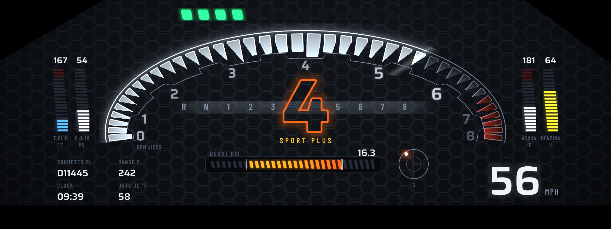
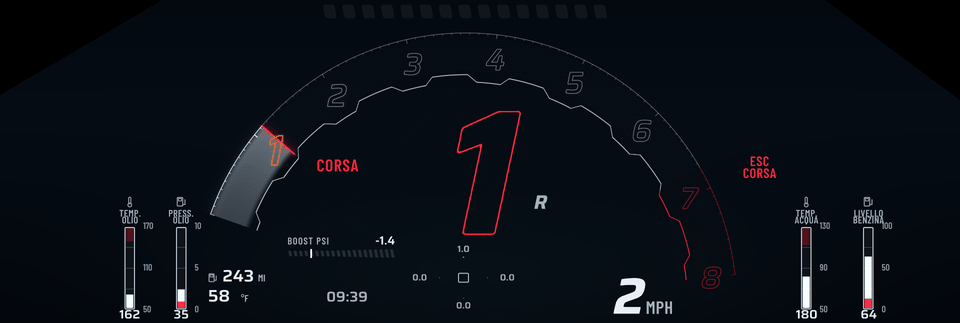
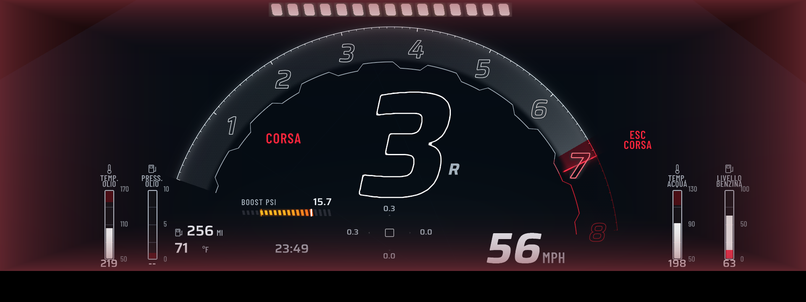
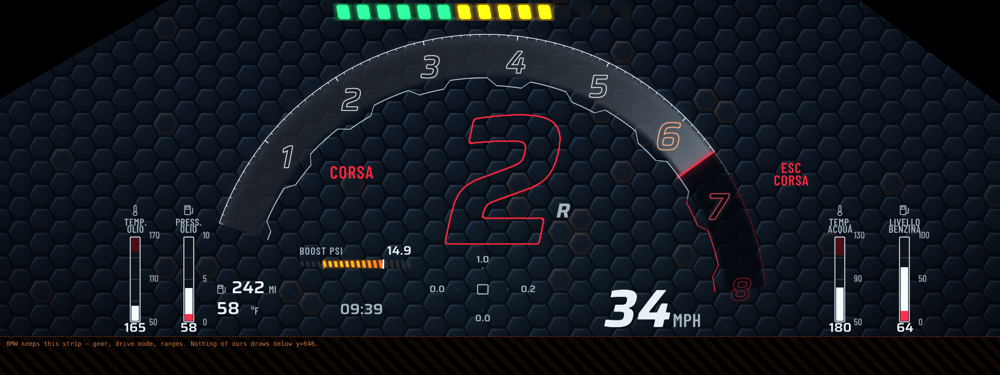
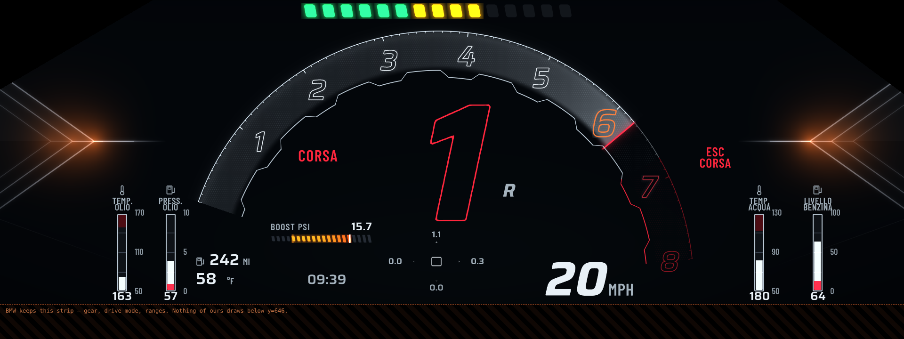
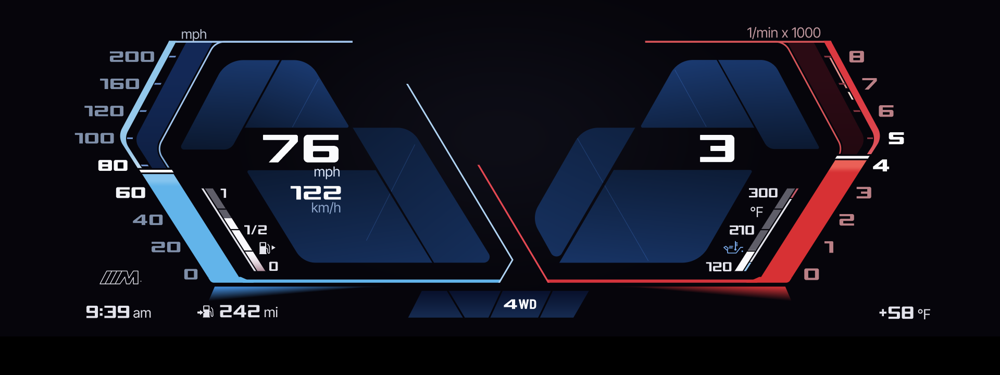
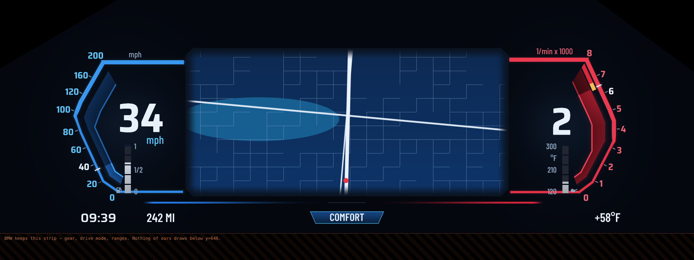
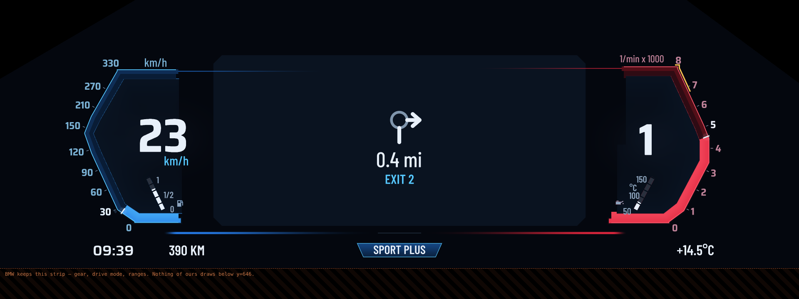

# MGU-Styles

Custom instrument clusters for BMW iDrive 7 (MGU), in two styles you switch
between on iDrive:

- **Toro**, after a modern Lamborghini: a wide rev band, a huge hollow gear
  numeral in arancio, Italian-labelled side pods, and three backgrounds
  (genuine Huracán, modern hex lattice, Revuelto). Plus two things the
  factory car never had, a **boost gauge** and **GT3 three-stage shift
  lights with a limiter flash**.
- **M**, after BMW M's iDrive 8 cluster, drawn on the iDrive 7 panel: a
  blue speed chevron on the left and a red rev chevron on the right that
  light from the bottom, big white figures, and a centre that shows the
  **Waze map**, **Turn View's front camera** or a turn card, faded into the
  frame.

It runs on a rooted head unit through
[`cluster-render`](https://github.com/robertnisipeanu/idrive-apps), installed
from the [MGU Store](https://github.com/robertnisipeanu/mgu-store).





> **Unofficial, and nothing to do with BMW AG or Automobili Lamborghini.**
> Changing what your cluster shows can distract you and may affect your
> warranty. The car's own warning lights and its bottom strip are never
> covered. Test it parked.

---

## Status

| | |
|---|---|
| Target car | 2023 **X3 M40i** (G01, B58, ZF 8HP) — the car it is developed against |
| Also profiled | other B58 cars, S58 M cars, plug-in hybrids (see Known limitations) |
| Units | imperial (mph, °F, psi); metric available |
| Head unit | iDrive 7 (ID7). iDrive 8 is planned — `cluster-render` already supports it |
| Package | **ready to install** from the MGU Store as **MGU Styles** (`mgustyles_toro`) |
| Tried on a car | **not yet** — the built package has been run end to end against a simulated car (below). The in-car checklist is **[docs/IN-CAR-TEST.md](docs/IN-CAR-TEST.md)** |

## The design

The geometry and art direction come from the **Huracán CORSA reconstruction
brief**, held as data in `src/theme/guide.js` so it can be read against the
document line by line.

- **The dial is a circle** — radius 590, centred at (930, 660), *below the
  screen*, swept 154.8° with the crown falling just past 5 on the brief's 1 → 10 scale
  (the sweep is kept when the scale is shortened to 8).
  One angle function, `θ(v) = -178 + 17.2v`, drives the ticks, the contour,
  the stipple and the numerals, so they cannot drift apart.

  I had previously fitted a superellipse to a traced photo and was wrong:
  that curvature was perspective in the photograph, not the dial.

- **Stepped inner perimeter** — the brief's own generator, a short radial
  shoulder at 0.12 of each interval, a plateau from 0.22 to 0.68, and back
  down by 0.80, between radii 483 and 499. A test checks the shader's ramps
  against that table.
- **Hollow inclined numerals**, narrow and leaning ~11°, white up the scale
  and red from the red sector. The slant is baked into the SDF atlas rather
  than sheared in the shader, so the field describes the real shape and the
  metrics come out right.
- **The gear glyph** is a red outline with a transparent interior, leaning
  12°, with CORSA to its left and the pale secondary R beside it.
- **Stipple in the band** — a fine regular point field in the annulus,
  which is what the Huracán's texture actually is at this scale. The
  hexagon lattice is the **modern** background option.
- **Side instruments** stay narrow: thermometer and pump icons, Italian
  labelling (Temp. Acqua, Livello Benzina), fixed scale markings separate
  from the moving level.

### Where this departs from the brief, and why

| | |
|---|---|
| Rendered as cluster-render **effect layers**, not SVG | the head unit gives us no other way to draw smoothly at 30 Hz |
| A **progressive lit run** up the dial as the rpm indication | the brief leaves this open and warns against inventing OEM behaviour, so it is a documented choice |
| **GT3 shift lights** and a **boost gauge** | separately asked for; the brief allows exactly that exception |
| The **far-left region** carries oil temperature and pressure | the brief says that area is unreadable in the photograph, so it is ours to use |
| The grid is **scaled to fit above y = 646** | the car keeps the bottom strip; the whole instrument scales as one, which is what the brief asks for |

### How the revs read

The dial runs **0 → 8** by default, because a B58 or S58 stops at 7,000:
the brief's sweep and proportions are kept, only the scale is shorter.
`Rev scale` in the iDrive settings sets the top (6,000 – 10,000; 10,000
gives the Lamborghini's own 1 → 10).

As the revs climb:

- **the band lights** — the stipple fills in the lit colour up to the
  current rpm, with a red needle at the leading edge;
- **each numeral pops** as the needle reaches it — it grows by up to 40 %
  and turns the accent colour, then settles back to white once passed;
  numerals in the red sector pop red;
- **the GT3 shift lights** fill green → yellow → red;
- **on the limiter** the shift lights go solid, the screen edges flash and
  the dial strobes, at the rate and strength you choose.



### Three backgrounds

`Background` keeps the **genuine** Huracán look (stipple annulus, faint
facets) or switches to:

- **modern**: the Lamborghini hexagon lattice — thin silver lines on the
  left and right only, glowing nodes at some of the joints, faint faceted
  glass inside each cell, and a black centre so the dial stays clean. It
  fades out behind the side pods to keep them readable.
- **revuelto**: the Revuelto's Y light signature, nested three deep on each
  side with the stem pointing at the dial, the accent colour burning at the
  junction, lighter and darker planes between the arms, and a long diagonal
  sweep behind.





## M — the iDrive 8 M style

Built to the **M iDrive 8 cluster guide**
([docs/M-IDRIVE8-BRIEF.md](docs/M-IDRIVE8-BRIEF.md)) and its photographs:
the guide's rail paths, colours and anchors, fitted onto the iDrive 7
panel. It is drawn to look like the factory M cluster, badge and all; the figures
are Saira Semi Condensed (SIL OFL) and the fuel pump and oil can are drawn
in the shader. **Unofficial, and nothing to do with BMW AG** — see the
notice at the top.
In settings and the code it is the style `track`.



Each gauge is built the way the photographs show, measured off them:
a **bright chevron rail** on the guide's path, tapering from 13.5 units on
the upper limb to 7.6 on the lower; a gap; then the **value band**, a wide
ribbon parallel to the rail (42 units above the vertex, 22 below) that is
a deep tint when unlit and fills bright from the bottom; and a **thin
bright line** along its inner edge. The band's edges are mitred offsets of
the chevron, so its corners stay sharp. Scale numerals and short ticks sit
outside the rail, and the numeral at the marker turns white.

- **Speed (left):** blue, 0–200 mph (0–330 km/h) — evenly spaced labels
  with the top steps wider, as on the car. Big speed figure with its unit,
  and fuel as a vertical five-segment bar with 1 / ½ / 0 beside it.
- **Revs (right):** red, 0–8 (your rev scale), with a red run in the gap
  from your redline and an amber shift mark before it; the rail and band
  flash white on the limiter. Big gear figure, oil temperature as the
  mirrored vertical bar.
- **Lower rail:** clock and range left, BMW's drive-mode name in an
  angular lozenge in the middle, outside temperature right.
- **Centre:** one chamfered window, feathered over 40 design units exactly
  as the guide's checkpoint table says (`test/track.test.js`); it opens
  over 180 ms and closes over 110 ms, and nothing outside it ever moves or
  fades. At rest it shows the angular navy planes the car draws there; the
  map or camera replaces them as the window opens.

| Centre shows | What you see |
|---|---|
| **Waze map** | the phone's map from *Maps on cluster* — and the turn card when no map is up |
| **Turn View camera** | the front camera from IterioDev's *Turn View* |
| **Turn card only** | our own arrow, distance and instruction for the next turn |
| **Nothing** | the angular centre graphic alone |





### How the map and the camera get into the centre

Neither picture is ours: two other apps draw them, and M only asks and
makes room. Everything is set from MGU Styles' own page on iDrive — nothing
needs changing on the cluster or in the other apps. `src/car/centre.js`
does all of it.

- **Waze** ([Maps on cluster](https://github.com/robertnisipeanu/idrive-apps/blob/main/apps/robertn_waze_cluster/README.md)).
  Its service normally draws on the KOMBI's map slot, under BMW's gauges.
  While M is on the cluster with *Waze map* chosen, we ask its control
  socket to draw on the **panel** instead — the same scene we draw in, at
  z 0 in BMW's map window (416,120 1088×480) — and our frame at z 1 cuts
  the feathered window over it. The window sits wholly inside that map
  window. Whenever we stop wanting it (key-off, another style, *BMW
  original*, the app closing) we put the map back on its own slot, but only
  if we moved it; that is remembered across restarts. This is the approach
  bimmer-lab's Cluster Themes use. The map then draws above BMW's own map
  view, so the car's *Central display area* setting does not matter, and
  Waze's HUD map is off while it is inside the cluster (they share a
  scene). The **Waze on cluster** button on the app's page turns it on
  (and picks M) or off.
- **Turn View** ([IterioDev/car-apps](https://github.com/IterioDev/car-apps)).
  On iDrive 7 its tool draws the camera on the map slot, under the panel;
  our window over BMW's map area is how it shows. *Turn View camera*
  switches Turn View on (it is off at every car start) and off again when
  you leave, unless you had switched it on yourself. Its control socket
  also gives the next maneuver, which is where the turn card comes from.
  We only ever hold that socket for an instant: the Turn View tool starts
  its app (the part that asks the camera for a picture) only while nobody
  is connected. Turn View is closed-source under PolyForm Strict and is
  used as installed; nothing of it is copied here.

## Settings

On the car these are in the app's **Settings** screen on iDrive; changes apply
to the cluster within half a second.

| Setting | Values |
|---|---|
| Show on cluster | on / off (off = BMW's original cluster) |
| Style | Toro (Lamborghini Huracán) · M (iDrive 8 style) |
| M: centre shows | Waze map · Turn View camera · turn card only · nothing |
| M: colours | night · day (the guide's two palettes) |
| Car | X3 M40i (B58) · other B58 · M car (S58) · plug-in hybrid — sets the default redline, limiter and gear count |
| Toro: background | Genuine Huracán (stipple) · Modern hex lattice · Revuelto |
| Accent | arancio · giallo · rosso · verde · blu · viola · bianco |
| Rev band fill | full fill and needle · subtle · off |
| Mode label | Strada / Sport / Corsa · BMW's own names · always CORSA |
| Rev scale | 0–6,000 … 0–10,000 (default 0–8,000) |
| Redline | from the car, or 5,500 – 8,000 rpm |
| **Rev limiter** | from the car, or 6,000 – 9,000 rpm — where the limiter flash and the last shift light sit |
| Rev-limit flash | dial and screen edges · dial only · edges only · off |
| Shift lights | Lamborghini (blades closing on a hex core, bursts at the limit) · GT3 LEDs · single blade · off |
| Shake at the limiter | medium · hard · light · off — the whole cluster jolts in step with the bursts, played by the renderer itself |
| Colour applies to | lights and highlights · everything, gear and labels too |
| Holiday theme | crystal snow down both sides and a Christmas tree in a clean corner |
| Start-up message | on / off: *For my beautiful wife, Nicole Wali, I love you* (or other words, below), 6–20 s, then a slow fade into the cluster |
| Start at every startup | on: comes up with the car every time · off: each start begins with BMW's own, **Cluster on / off** brings it up for that drive |
| Boost gauge | on / off |
| Oil gauges (far left) | on / off — temperature and pressure (turbo pressure until BeeM-Flash supplies oil pressure) |
| Units | mph, °F, psi · km/h, °C, bar |
| Clock | 24-hour · 12-hour |

The redline and limiter are clamped and kept in order whatever is chosen.

**Your own start-up words.** iDrive settings can offer choices but no
keyboard, so the message has five ready-made sets of words and *Your own*.
For your own, put a plain text file named `mgu-styles-message.txt` at the
top of a USB stick, plug it in, and choose *Your own* (or change any
setting) — MGU Styles reads it and keeps a copy, so the stick can come out
again. Up to about 90 characters; letters, figures and `. , ' ! ? & - : +`
show, in the wide capitals the cluster uses. Where the head unit mounts
USB sticks has not been confirmed on the car yet (`/media`, `/run/media`
and `/mnt` are searched); if it is not found, the default words show.

**The iDrive page** steps through the four designs (Toro genuine, modern
hex lattice, Revuelto, M) with the ◀ ▶ arrows beside the sketch on the
touchscreen, or **Design** in the bar with the controller. It fills the
whole screen when the Store's renderer (`mgu-render`) is installed, which
the Store now pulls in with the app.
The preview takes more (`flashFromRpm`, `flashRate`, `flashStrength`,
`hexagons`, `hexSize`, `stipple`, `litColour`…) as query parameters, e.g.
`preview/index.html?background=modern&accent=blu&rpmLimiter=6500`; all of
them live in `src/theme/palette.js`. For M: `style=track`, `drive=SPORT`
shows the lozenge, and
`show=map|camera|magenta` puts a stand-in picture under the window,
`turn=left|right|bear|sharp|uturn|roundabout|keep|dest` shows the turn card.

## The one rule everything obeys

**Nothing draws at or below `y = 646`.**

The cluster's own bottom strip lives there. Cover it and the KOMBI decides
its gear readout is gone and draws a **fallback gear box over our artwork**,
which has been seen to persist until the head unit restarts. Several projects
found independently, on real cars, that a layout ending at 646 is clean.

`test/theme.test.js` enforces this, along with the factory keep-clear zones,
the 48-uniform-vector shader budget, and the reserved uniform names the head
unit refuses. Full detail: **[docs/CLUSTER-CONSTRAINTS.md](docs/CLUSTER-CONSTRAINTS.md)**.

## How it is built

Everything that moves is a **GLSL effect layer**. The renderer shares one
5500 KB/s link to the cluster, and a full 1920×720 RGBA frame is 5.5 MB —
about one frame a second. Effect layers upload *nothing* per frame; animation
comes from `u_time` and a handful of uniforms, which is what makes smooth
graphics possible at all. Text is the only asset: a single baked SDF atlas
(1024², 116 KB) that stays crisp from a 17 px label to the 225 px gear.

```
src/geometry/panel.js    panel geometry, keep-clear zones, vehicle profiles
src/shaders/             GLSL ES 1.00: prelude, rev band, pods, boost, text
src/engine/text.js       SDF text layout (shared by preview and car)
src/engine/state.js      raw vehicle signals -> what the theme draws
src/theme/guide.js       the CORSA brief as data, and its fit to the MGU panel
src/theme/palette.js     colour schemes and every driver setting
src/theme/lambo.js       Toro: 49 layers
src/theme/track.js       M: the guide's layout, fit and feather
src/theme/mgeom.js       M: the guide's rail paths and scales, shared with the shaders
src/shaders/mcluster.js  M: rails, frame and turn arrow, paths written into the GLSL
src/theme/index.js       the styles, picked by settings.style
src/car/cluster.js       the theme -> cluster-render effect layers
src/car/centre.js        M's centre: Waze and Turn View, asked for, never held
src/car/vehicle.js       BMW SOME/IP signals -> raw readings
src/car/main.js          the service: signals in, uniforms out
app/                     the iDrive app shell (entry, manifest, icon)
apps/mgustyles_toro/     the staged package the Store builds (generated)
kit/                     the MGU App Kit runtime and builder (MIT, vendored)
preview/                 WebGL harness + a vehicle simulator
tools/                   staging, car simulator, atlas baker, screenshotter
test/                    the constraints and the protocol, enforced
```

On the car, `src/car/main.js` takes a `host` that supplies the three things
only the head unit can give — signal subscriptions, settings and a log — so
the service is driven by a fake host in `test/service.test.js` and the app
shell stays a thin adapter. The driver creates the atlas as a single `r8`
asset, one effect layer per theme layer, and then sends **only the uniforms
that changed**: a repeated state costs nothing, and thirty seconds of hard
driving at 30 Hz measures under 120 KB/s against the 5500 KB/s the whole
head unit shares.

It follows the car's own state (`VehicleCondition`): it draws only in drive
readiness and hands the cluster back to BMW at key-off, so nothing is ever
drawn over a sleeping cluster. Every callback is guarded, because an app
that crashes on the head unit can be uninstalled by the platform.

The preview runs **WebGL 1 on purpose** — that is GLSL ES 1.00, the dialect
the head unit's glslang compiles. A shader that works in the preview is the
shader that ships.

## Installing on the car

1. The head unit needs root and the **MGU Store**.
2. Add this repository as a source in the Store. It reads
   [`mgu-repo.json`](mgu-repo.json), which points at the ready-staged app in
   `apps/mgustyles_toro/` and builds it with the kit in `kit/`.
3. Install **MGU Styles**. The Store pulls in `cluster-render` (≥ 0.6.9),
   `mgu-render` (≥ 0.6.11, the full-screen iDrive page) and `mgu-deploy`
   as dependencies.
4. Open MGU Styles on iDrive and press **Cluster on / off**. It starts
   with the car from then on (unless *Start at every startup* is off);
   the same button hands the cluster back to BMW.
   Pick the style in **Settings**.
5. For M's centre: install **Maps on cluster** (`robertnisipeanu/idrive-apps`)
   for Waze, and/or **Turn View** (`IterioDev/car-apps`) for the camera,
   from their own Store sources. Then press **Waze on cluster** on MGU
   Styles' page, or pick the centre in Settings. Nothing else to set:
   MGU Styles moves the map in and out by itself. Only Turn View's
   *camera* needs the car's **Instrument cluster > Central display area**
   on **Map view**, because Turn View draws its camera there (its own
   requirement). Without either app M still works; the centre stays quiet.

It draws only when the car is in drive readiness and `cluster-render` is
running, and gives the cluster back at key-off. Follow
**[docs/IN-CAR-TEST.md](docs/IN-CAR-TEST.md)** for the first drive.

## Running it

```sh
npm test          # unit tests, package staging check, then every shader compiled on a GPU
npm run car-sim   # build the real package and run it against a simulated car
npm run shot      # render a frame to build/shot.png
npm run fonts && npm run atlas   # re-bake the SDF atlas from the OFL fonts
```

**`npm run car-sim`** is the closest thing to the car this repo can offer.
It builds the package with the kit's own builder, stands in for BMW's
oap-sdk, the native SOME/IP binding and cluster-render's socket, and runs
the built `app.js` unmodified through park → key-on → a pull to the
limiter → key-off. It fails if the app draws before the car is on, does not
draw while driving, or does not hand the cluster back. It then redraws
exactly what crossed the socket in WebGL 1 (`build/car-sim/car-*.png`) and
fails if any shader does not compile.

`CAR_SIM_THEME=track npm run car-sim` runs M with fake *Maps on
cluster* and *Turn View* services beside the fake renderer, and also fails
if Waze is moved into the cluster before the car is on, is not in it while
driving, is not given back at key-off, or if a Turn View connection is
held open. Its replay draws a stand-in map where Waze would draw.

After changing anything in `src/` or `app/`, run `node tools/stage-app.js`
to refresh `apps/mgustyles_toro/`; `npm test` fails if you forget.

For a live preview, serve the repo root and open `preview/index.html`
(`t=` seconds into the drive, `freeze=1`, `units=metric`, `profile=`,
`strip=off`).

## Known limitations

- **Not yet run on a car.** The signal decoders use the field names,
  invalid markers and scalings other projects read on real cars, and the
  package runs end to end in simulation, but nothing here has been seen in
  a vehicle. Signals that do not arrive show dashes.
- **Oil pressure has no source wired up yet.** The reader hook is in
  `src/car/vehicle.js`; until something feeds it, it shows dashes. The G
  meter reads the car's lateral/longitudinal acceleration (CDS2); its sign
  convention needs checking in the car.
- **M cars and hybrids.** Some KOMBIs draw extra boxes over a panel layer
  (M cars at `793,289` and `1223,328`; hybrids an eDrive box at `1770,170`).
  The layout is drawn for the X3 M40i, which has neither, so on those cars
  parts of the centre and the fuel readout are covered. The overlaps are
  listed in `test/theme.test.js` and the test fails if they change.
- **Shift lights sit above the rev band**, in the top centre. Whether the
  factory telltale row is drawn over that area is not confirmed; the rev band
  itself also carries the three-stage colour, so the shift cue survives
  either way. Turn them off with the `shiftLights` setting.
- **The brief's left-hand region is a reconstruction gap.** It is obscured
  in the photograph, so what is there is ours, not a match.
- **No visual comparison against the brief's own reference image** has been
  done — that photo was not supplied with the brief here. The geometry
  follows the written specification.
- **Boost** needs a turbocharged engine and comes from the Sport Display,
  falling back to reading the engine unit directly.
- **M's centre depends on two other apps' behaviour on your car.**
  Moving Waze into the panel is the method bimmer-lab's Cluster Themes use
  on cars; it has not been run with this app yet. Do not run both apps'
  map windows at once: whichever asked last owns the map.
- **Turn View and Waze compete for the cluster's video.** Turn View's own
  advice is not to use both on the cluster; the cluster and HUD together
  show at most two videos. Choosing *Turn View camera* gives the Waze map
  back to its own slot, where Turn View's camera hides it.
- **The camera window shows whatever the KOMBI draws in its map area.**
  Turn View's camera lands on the map slot under BMW's gauges, so any
  readout BMW draws over its own map in Map view shows through the window
  too. That has to be judged in the car.
- **The turn card has a distance but no street name.** Turn View's tool
  reports the maneuver and its formatted distance only. Waze sends no turns
  to the car (Turn View's notes), so with Waze the card stays empty.
- **On M cars** the KOMBI's M boxes fall inside M's centre; readouts
  stay clear of them, what the centre shows may be covered.

## Credits

- **[bimmer-lab/apps](https://github.com/bimmer-lab/apps)** — showing the
  Waze map inside a cluster theme through waze-on-cluster's control socket,
  and BMW's map window on the panel (416,120 1088×480).
- **[IterioDev/car-apps](https://github.com/IterioDev/car-apps)** — Turn
  View, used as installed, through its documented control socket.

This project is built on what others worked out, mostly on their own cars:

- **[robertnisipeanu/idrive-apps](https://github.com/robertnisipeanu/idrive-apps)**
  — `cluster-render`, the renderer every app draws through, and its protocol.
- **[robertnisipeanu/mgu-store](https://github.com/robertnisipeanu/mgu-store)**
  — the Store and its packaging rules.
- **[Vizualyse/idrive-apps](https://github.com/Vizualyse/idrive-apps)** — the
  measurements behind the bottom-strip rule, the cut glass corners, the
  telltale positions and the reserved-uniform trap.
- **[ALMSTRA/idv7lol](https://github.com/ALMSTRA/idv7lol)** — the `y=646` cut,
  the 48-vector shader budget, the boost DIDs, and the **MGU App Kit**
  (MIT) vendored in `kit/` that runs and packages the app.
- **[ZEKAI-Design/ID7-Cluster-Themes](https://github.com/ZEKAI-Design/ID7-Cluster-Themes)**,
  **[NamelsMissing/mgu-apps](https://github.com/NamelsMissing/mgu-apps)**,
  **[cauliflowermossgrape/idrive7-apps](https://github.com/cauliflowermossgrape/idrive7-apps)**
  — app structure, signal catalogues and layout practice.

Fonts: **Saira** (incl. Semi Condensed), **Chakra Petch**, **Michroma** and **Barlow Condensed**, SIL OFL 1.1, baked into
`assets/fonts/`. Licences in `assets/fonts/OFL.txt`.
