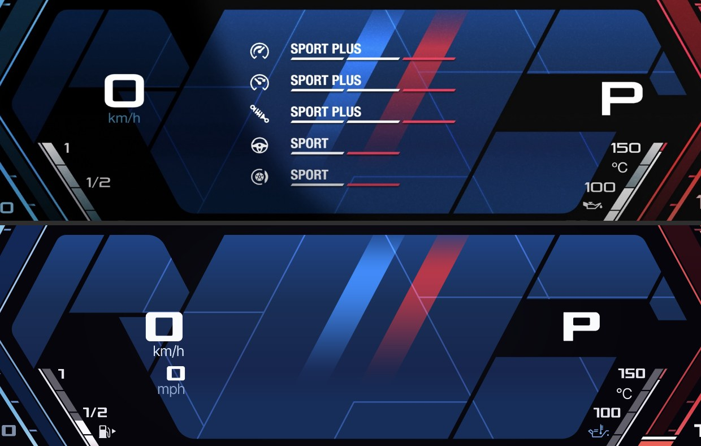

# M Sport Plus — measurements

M Sport Plus is M Sport with another middle. This is where that middle
comes from and how it was laid into M Sport's coordinates; everything else
about the style is in [MEASUREMENTS.md](MEASUREMENTS.md).

Like M Sport it is a reference-matched reconstruction for the owner's own
car, not a BMW drawing.

## 1. The pictures

| | |
|---|---|
| The middle | [`m-plus-reference.jpg`](m-plus-reference.jpg) (supplied as `IMG_9427.jpeg`), 2576 × 967, SHA-256 `f7d38a5adaf906008751e7331acaa9578dcaeecea2dd9ec31158ea440c1d152c` |
| Where the map goes | [`m-plus-waze-area.jpg`](m-plus-waze-area.jpg) (supplied as `IMG_9465.jpeg`), 618 × 529: a crop of the same picture at 0.52 of its size, the area marked in red by hand. SHA-256 `513f0dfd19db3bdb0f8908e8ca129d4556ce2db5c419377145ad21da95aa8e90` |
| What it shows | the M setup screen: the same two dials, a wide centre plate with a list of driving modes over the M stripes, speed `0`, gear `P` |

It is a clean capture, not a photograph: its edges fit straight lines to
under half a pixel, both top lines are level at the same height, and it is
mirror-true about x = 1299.4. Its proportions are the cluster's own
(2576 : 967 = 1920 : 720). The left third lies under a soft diagonal
shadow that darkens plates and background alike; that is in the capture,
not the design, and is not drawn.

**What was taken from it:** the plates, the stripes, the lattice of fine
lines, the plates' fall of light, where the lower rails end, and — from
the marked crop — where the map goes. **What was not:** the list (the map
takes its place), where its speed and gear stand (the owner asked for the
middle only, so the figures stay M Sport's: in this picture they stand
about 60 units further out), its single speed, `READY`, the yellow shift
marks, and its numerals' narrower cut.

## 2. Into M Sport's coordinates

The two pictures do not share a shape: this one is 4.5 % taller for its
width than the M View photograph (which was taken a little from above).
So it comes across by one scale each way, fixed by the dials themselves:

| Landmark | In this picture | On the artboard | Gives |
|---|---|---|---|
| Dials' axis | x 1299.4 | x 903.8 | |
| Fine contour's bend, left | (385.7, 440.8) | (264.5, 270.7) | 0.6997 across at that height |
| Fine contour at the top line / at the plates' foot | | | 0.7029 / 0.7044 across |
| Top line | y 142.0 | y 70.1 | |
| Lower rail | y 809.1 | y 516.25 | 1 / 1.4952 down |

**x = 903.8 + (X − 1299.4) × 0.702, y = 70.1 + (Y − 142.0) / 1.4952.** One
scale across (the mean of the three) keeps every diagonal parallel, at the
cost of at most 2 units beside the dials; the bend's height comes out 0.7
of a unit from M Sport's own. Radii scale by the mean, 0.685.

Every diagonal in the picture has one slope, 0.5028 (fits from 0.4966 to
0.5093), which is **0.5278** on the artboard. Corners were measured, then
set exactly on that lean; none moved more than 1.5 units. (The foot of the
leftmost plate follows the dial's lower limb instead, 0.611.)

## 3. The middle

All on the artboard; the numbers are `PLUS` in `src/theme/mgeom.js`.

**Plates** — seven, top edge y 107.0, foot y 467.3, corners clockwise:

| Plate | Corners | Radii |
|---|---|---|
| A (far left) | (385.6, 107.0) (464.5, 107.0) (339.6, 343.7) (297.2, 274.4) | 19.2, 0, 0, 24.7 |
| B (over the speed) | (474.5, 107.0) (561.6, 107.0) (615.2, 208.6) (596.3, 244.5) (401.9, 244.5) | 0, 33.9, 0, 0, 0 |
| B2 (under it) | (490.3, 252.2) (592.5, 252.2) (541.4, 349.0) | — |
| C (the centre) | (677.1, 107.0) (1262.0, 107.0) (1071.8, 467.3) (603.6, 467.3) (545.3, 356.8) | 0, 0, 0, 35.3, 0 |
| D (over the gear) | (1271.0, 107.0) (1415.2, 107.0) (1449.6, 172.1) (1424.1, 220.4) (1211.1, 220.4) | 0, 23.0, 0, 0, 0 |
| F (beside it) | (1453.8, 179.7) (1495.0, 257.8) (1444.6, 257.8) (1428.6, 227.5) | — |
| E (under the gear) | (1157.1, 322.8) (1370.7, 322.8) (1294.4, 467.3) (1080.9, 467.3) | 0, 0, 35.3, 0 |

The black between the centre plate and the right-hand ones is 9.0 wide;
between B and B2, 7.7 high. The gear stands on the black band between D
and E, the speed over the cut between B and B2.

**Light** — one fall for all seven, by height: (32, 67, 132) at y 110,
(25, 47, 87) at 228, (23, 38, 78) at 346, (23, 46, 90) from 404 down. The
right-hand plates and the centre plate's unshadowed part agree with it to
2 – 3 units at every height.

**Stripes** — two bands on the lean across the centre plate,
x = b − 0.5278·y: light blue from b = 996.7 to 1052.9, red from 1110.9 to
1166.8 (56 wide each, 58 of plate between: three bands alike). Blue is
(65, 138, 247) and red (199, 56, 71) at full strength. Their strength
runs with height: 0.2 at the plate's top edge, full at y 173, half at 277,
gone by 380 (`smoothstep(80, 173, y) · (1 − smoothstep(173, 380, y))`,
the red at 0.9 of it), which follows the picture to within 0.1.

**Lattice** — nine fine lines 2.5 wide, on the lean or level, each
starting and stopping on another or on a plate's edge (they are not seen
in the black between plates). About (30, 44, 78) lighter than the plate
under them, a little more where the plate is lighter.

**Rails** — with no centre lines, the blue rail runs in to x 854.4 and the
red starts at 952.8 (a gap of 98 about the axis), each cut on the lean.

## 4. The map's window

The marked crop is 0.52 of the picture's size with its corner at
(690.8, 69.9). The red line was drawn by hand, so it is read as its four
sides:

| Side | The marker | The window |
|---|---|---|
| Top | along the centre plate's top edge | the plate's top edge, y 107 |
| Right | parallel to the plate's right edge, 76 – 90 px inside it | parallel to it, 58.6 units inside |
| Foot | along the plate's foot | the plate's foot, y 467.3 |
| Left | from 60 px inside the plate's top left corner, steeper than the plate's edge (0.357 against 0.5), to its bottom left | that line, (719.6, 107) to (592.0, 445.3), then down the plate's own lower left edge |

The left side being steeper than the plate's edge is what keeps the map
out from under the speed, the second speed and their units: taken parallel
to the plate's edge instead, the map would have shown behind them.

The outline, clockwise: (719.6, 107.0) (1203.4, 107.0) (1013.2, 467.3)
(603.6, 467.3) (592.0, 445.3), its corners rounded by 40 (10 on the short
side at the bottom left).

**The fade.** The centre plate's own alpha falls from 1 to 0 between 6 and
46 units inside that outline, on 6t⁵ − 15t⁴ + 10t³: level at both ends and
its slope too, so there is no line where the fade begins or where it ends.
At half-way in (26 units) the map and the plate are half and half. The
stripes and lattice are part of the plate and go with it.

**The glass behind.** The black back glass has a plain hole where both the
outline and the centre plate cover it, drawn in two units. So the hole's
edge is always under plate that has not begun to thin, the fade is the
plate's alone — map and plate, nothing dark between — and nothing can show
past the plate's rounded corner.

On the panel the outline spans x 612.7 – 1268.6, y 118.2 – 489.3, and the
first row with any picture in it is 124: inside BMW's map window
(416, 120, 1088 × 480), where Waze and Turn View's camera land.

## 5. The numbers at the needle

Each scale numeral grows by a fifth as the marker comes level with it:
size 1 + 0.20 · w²(3 − 2w), w = 1 − |ticks from the marker| (0 beyond one
tick). It grows about its own middle and stays level with its tick. A
fifth is what fits at the tightest numeral — `150` / `100`, at the dial's
elbow — which has 7.7 px to the car's tyre-pressure telltale on one side
and 12.1 px to the rim on the other; that one numeral grows from a point
nearer the telltale, so it ends 2 px clear of it and 2.8 px clear of the
rim. Every other numeral has 12 px or more to its rim when grown.

## 6. How close the middle is

`python3 tools/m-plus-compare.py` carries the picture onto the artboard,
renders the style there 1:1 and writes the two, their overlay, the middle
alone and a plate-or-not map into `build/m-plus-compare/`. In the
unshadowed half of the middle, leaving out a band round every white figure
and word, plate-or-not agrees on **97.2 %** of the area and the plates
overlap by **96.2 %**; what differs is a 1 – 2 px fringe along edges and
where the red stripe fades.

Not matched, by choice: the shadow over the picture's left, the list, and
where the picture's own figures stand.
