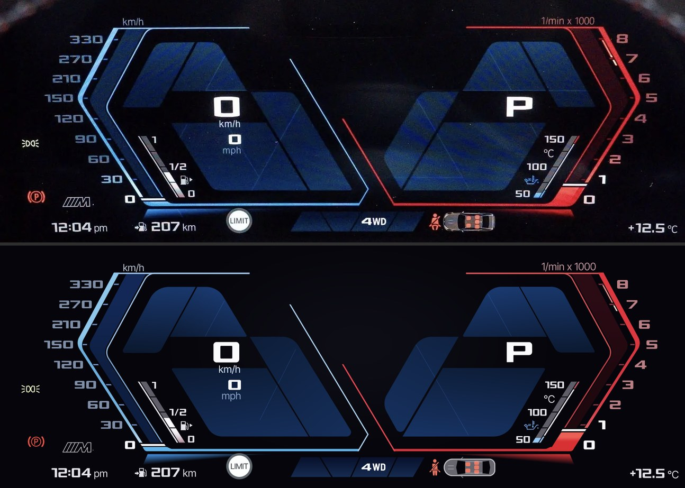
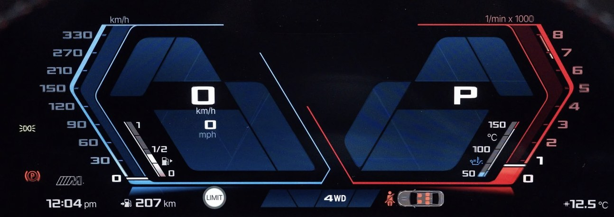
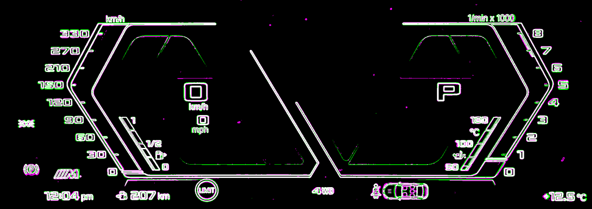

# M Sport (the M View) — measurements

What M Sport (`src/theme/track.js`, style `track`) is drawn from, how
each number was taken off the reference frame, and how closely the render
matches it. The guide these answer is [M-VIEW-SPEC.md](M-VIEW-SPEC.md)
(sections 11 and 12).

This is a **reference-matched reconstruction** of one photograph. Nothing
here is a BMW drawing, font file or specification, and none of it is
claimed to be factory-exact.

## 1. The reference

| | |
|---|---|
| File | [`m-view-reference.jpg`](m-view-reference.jpg) (supplied as `IMG_9460.jpeg`) |
| SHA-256 | `2216e4ac70fc7a54801c49cde3696a84dc76bf16eb840a6571e195444a84936e` |
| Size | 1726 × 612, RGB JPEG, EXIF orientation 1 (upright) |
| Crop used | the whole frame, unscaled: x 0 – 1726, y 0 – 612 |
| State shown | 0 km/h, 0 mph, P, engine idling (738 rpm), parking brake and side lights on, seat belt lamp, LIMIT, 4WD, 12:04 pm, 207 km, +12.5 °C |

It is a hand-held photograph of a curved display, so it carries things a
drawing does not: grain, moiré in the blue plates, glow around bright
strokes, and a little geometry of its own (section 3).

## 2. Coordinates

Everything is kept in the photograph's own pixels — the **artboard**,
1726 × 612, origin top-left, y down. `src/theme/mgeom.js` holds the
geometry in those units; the shaders are written in them too (each layer is
told where it sits on the artboard through `u_art`), and the layout asks
`px()` / `py()` for target pixels. So the whole design is carried to a
target by three numbers, the fit:

| Target | scale | origin | used for |
|---|---:|---|---|
| The car's panel, 1920 × 720 | 1.03 | (29.1, 8) | the cluster. The dials' axis (x 903.8) lands on the panel's centre (960), the frame ends at y 638.4 — above the car's own strip at 646 — and the speed scale clears the tyre-pressure telltale |
| The artboard itself | 1 | (0, 0) | the comparison (`art=native`): one render pixel to one pixel of the photograph, nothing resampled |

The aspect ratio is fixed; `MGUMGeom.setFit()` is the only place a target is
set (`test/track.test.js` builds at other scales to hold that true).

## 3. How it was measured

- **Edges.** Along each straight edge, the sub-pixel position where the
  brightness crosses half-way between its two sides was taken on 20 – 60
  scan lines, and a least-squares line fitted through them. Residuals were
  0.1 – 1.0 px. A line is written `[a, b]`: `x = a·y + b`.
- **Radii.** A corner's radius is the one whose outline best separates
  plate from background in a window round the corner (plates), or that
  best follows the stroke's measured centre line (the dials' contour).
- **Colours.** Means over flat areas well inside each shape, away from
  glow; gradients as a plane fitted to the plate's own pixels.
- **Figures.** Stroke widths, corner radii and counters measured on the
  speed `0`, the gear `P`, `330` and `8` at 6× nearest-neighbour.

**Symmetry and the photograph's own geometry.** The two dials are drawn as
exact mirror images about x = 903.8. The photograph does not quite show
that, for reasons that belong to the camera, not the design:

| What the photograph shows | Size | What was done |
|---|---|---|
| The rev dial, against the speed dial's mirror image, leans outward towards its foot | 0 px at y 95, 1.8 px at y 210, 3.2 px at y 460 | each dial line is the **mean** of the left one and the mirrored right one: at most 1.6 px from either |
| The frame is turned about a tenth of a degree (right side higher) | the top lines: blue 69.1 – 72.7, red 67.1 – 71.4 | the pair's mean, 68.4 – 71.8, level |
| Red strokes are about 1 px wider than blue ones at half height, and dimmer | contour 3.9 vs 4.9, rim 14.0 vs 14.6 | not copied: the lower rails, equally bright, are the same width (6.4) on both sides, so this is the red channel's blur |
| The red top line runs further in than the blue one's mirror | 4.2 px | copied (`topX1R`): other features at that height mirror to within 1 px, so it is in the picture, not the lens |

A level line is drawn level and a mirror pair as a mirror pair because on
the car's flat panel that is what reads as right; the price is the 1 – 2 px
listed in section 8.

## 4. Geometry

All in artboard units. The complete, current numbers are
`src/theme/mgeom.js`; this is how to read them.

**Scale.** Linear in height, not along the rail: tick *k* (0 – 8) is at
y = 503.4 − 50.7·k, on both dials. The marker is a level white bar at the
value's own height. Speed numerals are uneven above the fifth tick, as on
the car: km/h 0 30 60 90 120 150 210 270 330; mph 0 20 40 60 80 100 120
160 200. Revs 0 – 8 (×1000).

**Left dial** (the right is its mirror):

| Part | Upper limb | Lower limb | Notes |
|---|---|---|---|
| Rim, outer edge | [−0.538, 323.84] | [0.6385, 33.32] | shoulder radius 29.5; level width 13.8 above, 7.8 below; from y 68.4 to 497.6 |
| Dark channel, outer edge | [−0.5301, 356.61] | [0.6421, 59.13] | radius 26; its inner edge stays 5.0 / 4.5 (level) from the contour |
| Fine contour, centre line | [−0.5423, 411.26] | [0.6347, 92.67] | 2.9 wide; shoulder radius 29; rounds into the top line with radius 28.5 |
| Top line | y 68.4 – 71.8, to x 628.9 (red: 633.1 in the mirror) | | |
| Ticks | 1.8 inside the rim, 10.7 long, 3.0 high | | |
| Marker | 5.0 high, from the rim's outer edge to 3.0 short of the contour | | |
| Base and rail | tab from y 508.4, stepping down at x 420.5 – 431.5 to the rail, y 513.3 – 519.2 | | |

**Centre lines.** Cyan: (730.6, 148.5) → (927.2, 476.6), elbow, → (902.1,
519.2), 2.9 wide. Red: (863.4, 299.5) → (994.5, 519.2), 3.2 wide. They are
not mirror images: both lean the same way.

**Plates.** Eight convex slabs, corners clockwise; a radius per corner;
light as a plane (brightness on the blue channel at a point, change per
unit right and down), tinted (0.235, 0.515, 1.0):

| Plate | Corners | Radii | Light |
|---|---|---|---|
| LU1 | (393.6, 104.3) (493.0, 104.3) (401.8, 271.0) (305.6, 271.0) | 53, 0, 21, 5.5 | 77.4 at (399, 187); +0.019, −0.355 |
| LU2 | (497.0, 104.3) (547.7, 104.3) (623.7, 230.3) (428.0, 230.3) | 0, 50, 3, 0 | 83.7 at (524, 179); +0.129, −0.368 |
| LL1 | (430.6, 309.5) (672.1, 309.5) (777.5, 481.9) (536.7, 481.9) | 3, 0, 0, 42 | 71.4 at (605, 397); +0.026, +0.182 |
| LL2 | (629.3, 230.3) (737.9, 230.3) (893.2, 481.9) (780.8, 481.9) | 0, 46, 11, 0 | 73.8 at (761, 357); +0.059, +0.076 |
| RU1 | (1236.1, 104.0) (1307.6, 104.0) (1377.8, 230.3) (1164.5, 230.3) | 47, 0, 0, 3 | 85.4 at (1272, 177); −0.047, −0.355 |
| RU2 | (1310.6, 104.0) (1411.7, 104.0) (1500.4, 270.0) (1403.5, 270.0) | 0, 37, 3, 21 | 77.8 at (1406, 187); −0.016, −0.335 |
| RL1 | (1115.9, 309.0) (1375.4, 309.0) (1275.1, 482.0) (1014.4, 482.0) | 0, 3, 56, 0 | 76.6 at (1195, 395); −0.023, +0.227 |
| RL2 | (1058.6, 230.3) (1155.7, 230.3) (1008.9, 482.0) (962.3, 398.2) | 50, 0, 11.5, 44 | 79.6 at (1049, 335); −0.042, +0.091 |

The plates are *not* mirror images of each other and keep their own lines.
The outer corners were first traced with radii of 11 – 26; the control-point
check (section 7) showed them 2 – 5 px out, and the fit above replaced them.

**Fuel and oil strips.** From y 343.5 to 497.5: a fine line 3.8 wide, its
left edge [0.6368, 128.4], and four parallelogram segments 14.7 wide, left
edge [0.6345, 135.7], cut at y 382.0, 420.3 and 460.2. Oil is the mirror;
its line is red above y 362 (hot) and blue below 481 (cold).

**Footer.** The four-pane panel: y 534.5 – 584.3, x 758.0 – 1069.5 at the
top, leaning −0.51 / −0.58; separators from x 806.5, 907.0, 1000.5 at the
top to 836.5, 884.0, 976.5 at the foot, 3.2 wide. The panes lighten
downwards, (9, 18, 46) to (21, 42, 79), all four alike. LIMIT: a disc of
radius 27 in a ring of 33 at (603, 557). The glow under each rail starts
level at y 526.5.

**The map's window** (ours, not in the photograph): the black field
between the two groups of plates, as three overlapping convex pieces, the
picture fading in from 7 units inside the plates' edges over 22.

## 5. Colours

sRGB, 0 – 255, as sampled; all in `K` at the top of `src/theme/track.js`.

| | | | |
|---|---|---|---|
| Speed numerals | 127 143 169 | Rev numerals | 186 128 134 |
| Blue rim, upper / lower limb | 143 198 234 / 105 172 220 | Red rim | 220 56 64 / 214 54 64 |
| Blue contour | 162 198 238 → 124 168 214 | Red contour | 214 84 88 → 196 64 72 |
| Blue channel | 14 30 64 (×1.35 at the top) | Red channel | 32 8 15 |
| Blue fill, base → under the marker | 98 180 234 → 133 196 239 | Red fill | 215 49 52 → 234 96 87 |
| Blue rail / its glow | 98 180 234 / 64 136 212 | Red rail / its glow | 210 52 60 / 200 48 52 |
| Cyan centre line | 176 212 244 | Red centre line | 228 72 82 |
| Figures | 250 251 253 | Footer figures, strip labels | 228 228 236 |
| Unit under the speed / under the second speed | 222 234 255 / 142 166 204 | Glass | 6 5 11, lifting to 13 13 22 in the middle |
| Strip: lit / unlit / fuel's foot | 250 249 253 / 95 94 105 / 172 138 152 | Oil: hot / cold / its symbol | 196 90 104 / 150 200 244 / 122 170 234 |

Measured against the render, the dark channel agrees to within 4 units at
every height on both dials.

## 6. Lettering

No ordinary font has the dial's figures, so they are **drawn**
(`tools/mglyphs.py`) from bars and rounded boxes to the measured strokes and
baked into the same signed-distance atlas as everything else
(`tools/bake-atlas.py`):

| Face | Width / height | Upright stroke | Level stroke | Outer radius | Used for |
|---|---:|---:|---:|---:|---|
| `mw` | 1.265 | 0.34 | 0.19 | 0.155 | dial numerals (19.6 and 21.6 high), speed (51.6), second speed (25.3), gear (50.8) |
| `mn` | 0.935 | 0.255 | 0.17 | 0.125 | clock, range, temperature (23.0), strip labels (17.1) |
| `mi` | — | — | — | — | symbols: fuel pump, oil can, the outlined M mark, range arrow, and the fixture's lamps |

(all in figure heights). The small words (`km/h`, `mph`, `1/min x 1000`,
`pm`, `km`, `°C`, `LIMIT`) are set in **Inter Tight 400**, chosen by
measuring fourteen open fonts against the photograph's word widths
(`km/h` 52.8 against 52, `mph` 46.5 against 46, `1/min x 1000` 133 against
133); `WD` and the driving mode in **Barlow Semi Condensed 700**. Both are
SIL OFL. They are the closest open matches, not the car's own type: at
400 % their letters are a little lighter than the photograph's.

Toro's glyphs are packed first and untouched: its 133 glyphs have the same
cells, pixel for pixel, as in Beta 1.

**The 7** (corrected in Beta 3). It was first drawn with its leg starting
at the bar's top right corner, which stood it too upright and too far
left. Measured on the rev scale's `7`, on `270` and on the footer's `207`,
in figure heights from the figure's left:

| | Leg at 0.3 down | at 0.5 | at 0.9 | Leaves the right side |
|---|---|---|---|---|
| Photograph, dial cut | 0.85 – 1.23 | 0.66 – 1.05 | 0.29 – 0.66 | at 0.26, below the bar (0.19) |
| First drawing | 0.72 – 1.06 | 0.58 – 0.93 | 0.32 – 0.67 | at the top corner |
| Now (`mw`) | 0.87 – 1.22 | 0.68 – 1.03 | 0.30 – 0.65 | at 0.25 |
| Photograph, footer cut | 0.63 – 0.91 | 0.50 – 0.79 | 0.23 – 0.53 | at 0.24 |
| Now (`mn`) | 0.63 – 0.90 | 0.50 – 0.77 | 0.24 – 0.51 | at 0.25 |

The bar runs the full width and ends square; the leg hangs from that end
and leans back to a level foot (`Face.seven` in `tools/mglyphs.py`: the
leg's level width, where it leaves, where its foot starts).

## 7. Control points

`node tools/m-points.js` works these out from `src/theme/mgeom.js` — the
same numbers the shaders are written from — so the list cannot drift from
the render. `tools/m-compare.py` marks each on the overlay
(`build/m-compare/points.png`) and, for every point on an edge or a stroke,
measures how far the photograph's picture sits from ours there: the
smallest shift at which a 21 px patch of the two agrees best.

**Result (Beta 2): 137 of 143 measured points are within 2 px, 116 within
1 px; mean 0.72 px, worst 3.16 px.** The 6 beyond 2 px:

- `L.rimI.up90` — 2.2 px
- `L.tick8` — 2.2 px
- `P.RL1.2` — 2.2 px
- `O.segR490` — 2.2 px
- `O.bottom` — 2.2 px
- `T.sep1.top` — 3.2 px

They are the photograph's own geometry of section 3 (the dials' feet and
the far left of the scale), and the soft top edge of the footer's panel.

177 control points (143 on an edge or a stroke).

**speed dial**

| point | x | y | kind | what |
|---|---:|---:|---|---|
| `L.rimO.up90` | 275.4 | 90 | edge | rim, outer edge, upper limb |
| `L.rimI.up90` | 289.2 | 90 | edge | rim, inner edge, upper limb |
| `L.con.up90` | 362.5 | 90 | line | fine contour, upper limb |
| `L.rimO.up150` | 243.1 | 150 | edge | rim, outer edge, upper limb |
| `L.rimI.up150` | 256.9 | 150 | edge | rim, inner edge, upper limb |
| `L.con.up150` | 329.9 | 150 | line | fine contour, upper limb |
| `L.rimO.up205` | 213.5 | 205 | edge | rim, outer edge, upper limb |
| `L.rimI.up205` | 227.3 | 205 | edge | rim, inner edge, upper limb |
| `L.con.up205` | 300.1 | 205 | line | fine contour, upper limb |
| `L.rimO.low300` | 224.9 | 300 | edge | rim, outer edge, lower limb |
| `L.con.low300` | 283.1 | 300 | line | fine contour, lower limb |
| `L.rimO.low380` | 275.9 | 380 | edge | rim, outer edge, lower limb |
| `L.con.low380` | 333.9 | 380 | line | fine contour, lower limb |
| `L.rimO.low460` | 327 | 460 | edge | rim, outer edge, lower limb |
| `L.con.low460` | 384.6 | 460 | line | fine contour, lower limb |
| `L.rimO.elbow` | 195.7 | 246.9 | edge | rim, outer edge, the shoulder's apex |
| `L.con.elbow` | 269.1 | 270.7 | line | fine contour, the shoulder's apex |
| `L.top.end` | 628.9 | 70.1 | line | the level top line, its inner end |
| `L.top.mid` | 480 | 70.1 | line | the level top line |
| `L.tick1` | 337.3 | 452.7 | line | scale tick 1 |
| `L.tick2` | 304.9 | 402 | line | scale tick 2 |
| `L.tick3` | 272.6 | 351.3 | line | scale tick 3 |
| `L.tick4` | 240.2 | 300.6 | line | scale tick 4 |
| `L.tick5` | 210.3 | 249.9 | line | scale tick 5 |
| `L.tick6` | 237.6 | 199.2 | line | scale tick 6 |
| `L.tick7` | 264.9 | 148.5 | line | scale tick 7 |
| `L.tick8` | 292.2 | 97.8 | line | scale tick 8 |
| `L.tab.step` | 420.5 | 508.4 | edge | the base tab, where it steps down to the rail |
| `L.rail.top` | 600 | 513.3 | edge | the lower rail, top edge |
| `L.rail.bottom` | 600 | 519.2 | edge | the lower rail, bottom edge |

**rev dial**

| point | x | y | kind | what |
|---|---:|---:|---|---|
| `R.rimO.up90` | 1532.2 | 90 | edge | rim, outer edge, upper limb |
| `R.rimI.up90` | 1518.4 | 90 | edge | rim, inner edge, upper limb |
| `R.con.up90` | 1445.1 | 90 | line | fine contour, upper limb |
| `R.rimO.up150` | 1564.5 | 150 | edge | rim, outer edge, upper limb |
| `R.rimI.up150` | 1550.7 | 150 | edge | rim, inner edge, upper limb |
| `R.con.up150` | 1477.7 | 150 | line | fine contour, upper limb |
| `R.rimO.up205` | 1594 | 205 | edge | rim, outer edge, upper limb |
| `R.rimI.up205` | 1580.3 | 205 | edge | rim, inner edge, upper limb |
| `R.con.up205` | 1507.5 | 205 | line | fine contour, upper limb |
| `R.rimO.low300` | 1582.7 | 300 | edge | rim, outer edge, lower limb |
| `R.con.low300` | 1524.5 | 300 | line | fine contour, lower limb |
| `R.rimO.low380` | 1531.6 | 380 | edge | rim, outer edge, lower limb |
| `R.con.low380` | 1473.7 | 380 | line | fine contour, lower limb |
| `R.rimO.low460` | 1480.6 | 460 | edge | rim, outer edge, lower limb |
| `R.con.low460` | 1423 | 460 | line | fine contour, lower limb |
| `R.rimO.elbow` | 1611.9 | 246.9 | edge | rim, outer edge, the shoulder's apex |
| `R.con.elbow` | 1538.5 | 270.7 | line | fine contour, the shoulder's apex |
| `R.top.end` | 1178.7 | 70.1 | line | the level top line, its inner end |
| `R.top.mid` | 1327.6 | 70.1 | line | the level top line |
| `R.tick1` | 1470.3 | 452.7 | line | scale tick 1 |
| `R.tick2` | 1502.7 | 402 | line | scale tick 2 |
| `R.tick3` | 1535 | 351.3 | line | scale tick 3 |
| `R.tick4` | 1567.4 | 300.6 | line | scale tick 4 |
| `R.tick5` | 1597.3 | 249.9 | line | scale tick 5 |
| `R.tick6` | 1570 | 199.2 | line | scale tick 6 |
| `R.tick7` | 1542.7 | 148.5 | line | scale tick 7 |
| `R.tick8` | 1515.4 | 97.8 | line | scale tick 8 |
| `R.tab.step` | 1387.1 | 508.4 | edge | the base tab, where it steps down to the rail |
| `R.rail.top` | 1207.6 | 513.3 | edge | the lower rail, top edge |
| `R.rail.bottom` | 1207.6 | 519.2 | edge | the lower rail, bottom edge |

**speed numerals**

| point | x | y | kind | what |
|---|---:|---:|---|---|
| `L.num0` | 340 | 503.4 | anchor | "0": right end of its ink, level with tick 0 |
| `L.num1` | 308 | 452.7 | anchor | "30": right end of its ink, level with tick 1 |
| `L.num2` | 275 | 402 | anchor | "60": right end of its ink, level with tick 2 |
| `L.num3` | 242 | 351.3 | anchor | "90": right end of its ink, level with tick 3 |
| `L.num4` | 209 | 300.6 | anchor | "120": right end of its ink, level with tick 4 |
| `L.num5` | 184 | 249.9 | anchor | "150": right end of its ink, level with tick 5 |
| `L.num6` | 202 | 199.2 | anchor | "210": right end of its ink, level with tick 6 |
| `L.num7` | 231 | 148.5 | anchor | "270": right end of its ink, level with tick 7 |
| `L.num8` | 259 | 97.8 | anchor | "330": right end of its ink, level with tick 8 |

**rev numerals**

| point | x | y | kind | what |
|---|---:|---:|---|---|
| `R.num0` | 1471 | 503.4 | anchor | "0": left end of its ink, level with tick 0 |
| `R.num1` | 1508.5 | 452.7 | anchor | "1": left end of its ink, level with tick 1 |
| `R.num2` | 1536.5 | 402 | anchor | "2": left end of its ink, level with tick 2 |
| `R.num3` | 1568.5 | 351.3 | anchor | "3": left end of its ink, level with tick 3 |
| `R.num4` | 1599.5 | 300.6 | anchor | "4": left end of its ink, level with tick 4 |
| `R.num5` | 1629 | 249.9 | anchor | "5": left end of its ink, level with tick 5 |
| `R.num6` | 1610 | 199.2 | anchor | "6": left end of its ink, level with tick 6 |
| `R.num7` | 1579 | 148.5 | anchor | "7": left end of its ink, level with tick 7 |
| `R.num8` | 1555 | 97.8 | anchor | "8": left end of its ink, level with tick 8 |

**centre lines**

| point | x | y | kind | what |
|---|---:|---:|---|---|
| `C.cyan.top` | 730.6 | 148.5 | line | cyan stroke, upper end |
| `C.cyan.mid` | 828.9 | 312.6 | line | cyan stroke, half-way |
| `C.cyan.elbow` | 927.2 | 476.6 | line | cyan stroke, the elbow |
| `C.cyan.foot` | 902.1 | 519.2 | line | cyan stroke, where it lands on the blue rail |
| `C.red.top` | 863.4 | 299.5 | line | red stroke, upper end |
| `C.red.mid` | 929 | 409.4 | line | red stroke, half-way |
| `C.red.foot` | 994.5 | 519.2 | line | red stroke, where it lands on the red rail |

**plates**

| point | x | y | kind | what |
|---|---:|---:|---|---|
| `P.LU1.0` | 398.2 | 111.9 | edge | plate LU1, corner 0 (radius 53, at the arc) |
| `P.LU1.1` | 493 | 104.3 | edge | plate LU1, corner 1 |
| `P.LU1.2` | 400.1 | 268.1 | edge | plate LU1, corner 2 (radius 21, at the arc) |
| `P.LU1.3` | 310 | 268.3 | edge | plate LU1, corner 3 (radius 5.5, at the arc) |
| `P.LU2.0` | 497 | 104.3 | edge | plate LU2, corner 0 |
| `P.LU2.1` | 544.1 | 110.8 | edge | plate LU2, corner 1 (radius 50, at the arc) |
| `P.LU2.2` | 621 | 228.8 | edge | plate LU2, corner 2 (radius 3, at the arc) |
| `P.LU2.3` | 428 | 230.3 | edge | plate LU2, corner 3 |
| `P.LL1.0` | 433.4 | 311 | edge | plate LL1, corner 0 (radius 3, at the arc) |
| `P.LL1.1` | 672.1 | 309.5 | edge | plate LL1, corner 1 |
| `P.LL1.2` | 777.5 | 481.9 | edge | plate LL1, corner 2 |
| `P.LL1.3` | 539.7 | 476.6 | edge | plate LL1, corner 3 (radius 42, at the arc) |
| `P.LL2.0` | 629.3 | 230.3 | edge | plate LL2, corner 0 |
| `P.LL2.1` | 734.6 | 236.1 | edge | plate LL2, corner 1 (radius 46, at the arc) |
| `P.LL2.2` | 883.1 | 476.3 | edge | plate LL2, corner 2 (radius 11, at the arc) |
| `P.LL2.3` | 780.8 | 481.9 | edge | plate LL2, corner 3 |
| `P.RU1.0` | 1239.8 | 110.4 | edge | plate RU1, corner 0 (radius 47, at the arc) |
| `P.RU1.1` | 1307.6 | 104 | edge | plate RU1, corner 1 |
| `P.RU1.2` | 1377.8 | 230.3 | edge | plate RU1, corner 2 |
| `P.RU1.3` | 1167.1 | 228.8 | edge | plate RU1, corner 3 (radius 3, at the arc) |
| `P.RU2.0` | 1310.6 | 104 | edge | plate RU2, corner 0 |
| `P.RU2.1` | 1408.5 | 109.3 | edge | plate RU2, corner 1 (radius 37, at the arc) |
| `P.RU2.2` | 1498 | 268.5 | edge | plate RU2, corner 2 (radius 3, at the arc) |
| `P.RU2.3` | 1405.2 | 267.1 | edge | plate RU2, corner 3 (radius 21, at the arc) |
| `P.RL1.0` | 1115.9 | 309 | edge | plate RL1, corner 0 |
| `P.RL1.1` | 1372.8 | 310.5 | edge | plate RL1, corner 1 (radius 3, at the arc) |
| `P.RL1.2` | 1270.8 | 474.5 | edge | plate RL1, corner 2 (radius 56, at the arc) |
| `P.RL1.3` | 1014.4 | 482 | edge | plate RL1, corner 3 |
| `P.RL2.0` | 1062.5 | 237 | edge | plate RL2, corner 0 (radius 50, at the arc) |
| `P.RL2.1` | 1155.7 | 230.3 | edge | plate RL2, corner 1 |
| `P.RL2.2` | 1009 | 470.3 | edge | plate RL2, corner 2 (radius 11.5, at the arc) |
| `P.RL2.3` | 968.8 | 398.2 | edge | plate RL2, corner 3 (radius 44, at the arc) |
| `P.hair0.a` | 565 | 140 | anchor | hairline 0, one end |
| `P.hair0.b` | 517 | 229 | anchor | hairline 0, the other |
| `P.hair1.a` | 745 | 262 | anchor | hairline 1, one end |
| `P.hair1.b` | 655 | 440 | anchor | hairline 1, the other |
| `P.hair2.a` | 1230 | 123 | anchor | hairline 2, one end |
| `P.hair2.b` | 1288 | 228 | anchor | hairline 2, the other |
| `P.hair3.a` | 1048 | 250 | anchor | hairline 3, one end |
| `P.hair3.b` | 1180 | 478 | anchor | hairline 3, the other |

**fuel strip**

| point | x | y | kind | what |
|---|---:|---:|---|---|
| `F.line352` | 354.1 | 351.5 | line | the fine line |
| `F.segL352` | 358.7 | 351.5 | edge | segments, the edge by the line |
| `F.segR352` | 373.4 | 351.5 | edge | segments, the far edge |
| `F.line421` | 398.1 | 420.5 | line | the fine line |
| `F.segL421` | 402.5 | 420.5 | edge | segments, the edge by the line |
| `F.segR421` | 417.2 | 420.5 | edge | segments, the far edge |
| `F.line490` | 442 | 489.5 | line | the fine line |
| `F.segL490` | 446.3 | 489.5 | edge | segments, the edge by the line |
| `F.segR490` | 461 | 489.5 | edge | segments, the far edge |
| `F.cut0` | 385.4 | 382 | line | the cut between segments 0 and 1 |
| `F.cut1` | 409.7 | 420.3 | line | the cut between segments 1 and 2 |
| `F.cut2` | 435 | 460.2 | line | the cut between segments 2 and 3 |
| `F.top` | 361 | 343.5 | edge | top of the strip |
| `F.bottom` | 458.7 | 497.5 | edge | foot of the strip |

**oil strip**

| point | x | y | kind | what |
|---|---:|---:|---|---|
| `O.line352` | 1453.5 | 351.5 | line | the fine line |
| `O.segL352` | 1448.9 | 351.5 | edge | segments, the edge by the line |
| `O.segR352` | 1434.2 | 351.5 | edge | segments, the far edge |
| `O.line421` | 1409.5 | 420.5 | line | the fine line |
| `O.segL421` | 1405.1 | 420.5 | edge | segments, the edge by the line |
| `O.segR421` | 1390.4 | 420.5 | edge | segments, the far edge |
| `O.line490` | 1365.6 | 489.5 | line | the fine line |
| `O.segL490` | 1361.3 | 489.5 | edge | segments, the edge by the line |
| `O.segR490` | 1346.6 | 489.5 | edge | segments, the far edge |
| `O.cut0` | 1422.2 | 382 | line | the cut between segments 0 and 1 |
| `O.cut1` | 1397.9 | 420.3 | line | the cut between segments 1 and 2 |
| `O.cut2` | 1372.6 | 460.2 | line | the cut between segments 2 and 3 |
| `O.top` | 1446.6 | 343.5 | edge | top of the strip |
| `O.bottom` | 1348.9 | 497.5 | edge | foot of the strip |

**footer**

| point | x | y | kind | what |
|---|---:|---:|---|---|
| `T.panel.tl` | 758 | 534.5 | edge | four-pane panel, top left |
| `T.panel.tr` | 1069.5 | 534.5 | edge | four-pane panel, top right |
| `T.panel.bl` | 732.6 | 584.3 | edge | four-pane panel, bottom left |
| `T.panel.br` | 1040.6 | 584.3 | edge | four-pane panel, bottom right |
| `T.sep0.top` | 806.5 | 534.5 | line | pane separator 0, top |
| `T.sep0.bottom` | 836.5 | 584.3 | line | pane separator 0, bottom |
| `T.sep1.top` | 907 | 534.5 | line | pane separator 1, top |
| `T.sep1.bottom` | 884 | 584.3 | line | pane separator 1, bottom |
| `T.sep2.top` | 1000.5 | 534.5 | line | pane separator 2, top |
| `T.sep2.bottom` | 976.5 | 584.3 | line | pane separator 2, bottom |
| `T.limit.n` | 603 | 530 | edge | LIMIT disc, its rim |
| `T.limit.e` | 630 | 557 | edge | LIMIT disc, its rim |
| `T.limit.s` | 603 | 584 | edge | LIMIT disc, its rim |
| `T.limit.w` | 576 | 557 | edge | LIMIT disc, its rim |
| `T.limit.c` | 603 | 557 | anchor | LIMIT disc, centre |
| `T.glow.L` | 406 | 526.5 | edge | the glow under the blue rail, its level top |
| `T.glow.R` | 1401.6 | 526.5 | edge | the glow under the red rail, its level top |

**readouts**

| point | x | y | kind | what |
|---|---:|---:|---|---|
| `N.speed` | 603 | 295 | anchor | speed: right end of its ink, on the baseline |
| `N.speed2` | 607.2 | 364.3 | anchor | second speed: right end of its ink, on the baseline |
| `N.gear` | 1308.8 | 294.4 | anchor | gear: its middle, on the baseline |
| `N.clock` | 130 | 585 | anchor | clock: left end of its ink, on the baseline |
| `N.range` | 382 | 583.8 | anchor | range: left end of its ink, on the baseline |
| `N.ambient` | 1674.3 | 586.6 | anchor | outside temperature: right end of its ink, on the baseline |
| `N.4wd` | 911 | 568.2 | anchor | "4WD": left end of its ink, on the baseline |


## 8. How close it is

`python3 tools/m-compare.py` renders the fixture on the artboard 1:1 and
writes the photograph, the render, a 50 % overlay, an edge map, a colour
difference map, a blink GIF, the guide's four regions and 400 % crops of
the `0`, `P`, `330`, `8`, LIMIT and the fuel and oil symbols into
`build/m-compare/`.

| Region | Mean colour difference (0 – 255) | Photograph's edges with one of ours within 2 px | Our edges with one of the photograph's within 2 px |
|---|---:|---:|---:|
| whole frame | 8.48 | 98.7 % | 98.1 % |
| A | 8.89 | 99.2 % | 98.5 % |
| B | 7.02 | 98.6 % | 95.6 % |
| C | 8.99 | 98.3 % | 97.1 % |
| D | 9.56 | 99.1 % | 97.6 % |

The same measures on the Beta 1 M style: colour 29.83, edges 26.0 % and
34.0 %.







The numbers cannot reach zero: the photograph's grain and moiré are worth
about 6 of the colour difference by themselves, and its edges are blurred
where ours are sharp.

**Remaining mismatches, measured:**

| What | How far | Why it stays |
|---|---|---|
| Dials' feet, right-hand strip | 1 – 3 px | the photograph's own lean (section 3); drawn as a true mirror pair |
| Top lines, far ends | ≤ 0.8 px | the photograph's tenth of a degree; drawn level |
| Plates' texture | — | moiré and grain; the plates are drawn as clean falls of light |
| Glow round bright strokes | 1 – 2 px of halo | camera bloom, not drawn; only the light under the two rails is |
| Small words | lighter by eye at 400 % | Inter Tight is the nearest open face, not the car's |
| Footer panel, top edge | soft over 5 px in the photograph, crisp in ours | |
| Fixture lamps: the car seen from above, the seat-belt figure, side lights | simplified shapes | they are the car's own warnings: drawn only in the fixture, never on the road (below) |
| LIMIT's ring | a little heavier than the photograph's | fixture only |

## 9. What is and is not drawn on the car

The photograph shows lamps — parking brake, side lights, seat belt, LIMIT,
the car seen from above. Those are the car's own warnings. The cluster
keeps drawing its real ones over any theme, and an imitation that could
disagree with them has no place on the road, so they exist **only in the
reference fixture** (`mFixture`: the preview's `fixture=m` and the
comparison). `test/track.test.js` holds that.

Everything else is live and shows only what the car reports: a reading
that is missing is left dark (no fuel level lit, no clock, no range, no
temperature), never a remembered or invented number.

## 10. Reproducing

```
npm run fonts && npm run atlas     # the glyph atlas (needs Python: Pillow, numpy, scipy, fonttools)
python3 tools/mglyphs.py build/glyphs.png      # a proof sheet of the drawn figures and symbols
npm run m-compare                  # the comparison, into build/m-compare/
python3 tools/m-compare.py --panel # the same on the car's 1920 x 720 panel, mapped back
python3 tools/m-zoom.py 520 232 110 76 6       # any part of it, enlarged
python3 tools/m-near.py out.png L.tick8 O.bottom   # round named control points
node tools/m-points.js             # the control points as a table
```
